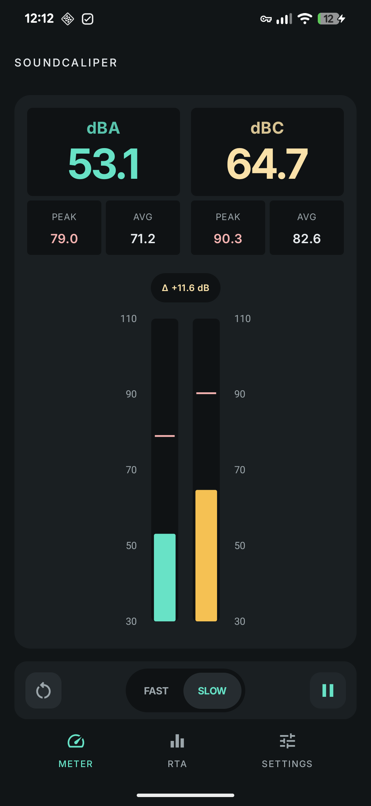
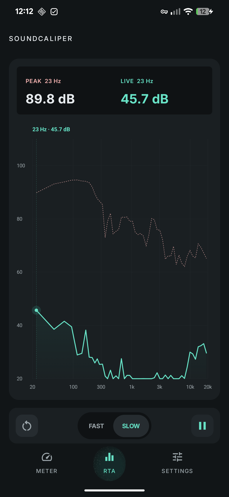
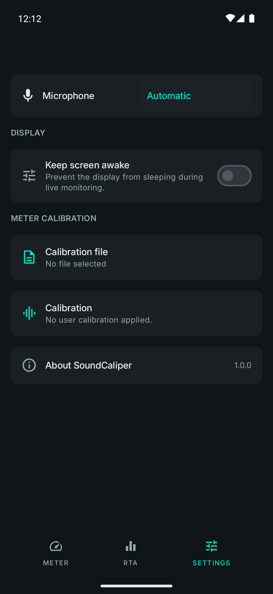

# SoundCaliper

SoundCaliper is an Android sound level meter and real-time audio spectrum analyzer. It measures noise levels with your phone's microphone, displays live decibel readings (dBA and dBC), shows audio frequencies across a visual spectrum, and supports calibration files (such as miniDSP UMIK-1) alongside per-input calibration.

## Screenshots

| Meter | RTA | Settings |
| --- | --- | --- |
|  |  |  |

## Features

- **Live sound levels**: View dBA (weighted for human hearing) and dBC (captures more low-frequency bass) readings, along with peak levels and running averages.
- **Adjustable response time**: Switch between Fast (125 ms) and Slow (1 s) response speeds, with pause and reset controls.
- **Audio spectrum analyzer (RTA)**: Visualizes sound frequencies from 20 Hz to 20 kHz in up to 64 bands, complete with peak-hold bars and tap-to-inspect frequencies.
- **Calibration file support**: Import microphone calibration files (such as miniDSP UMIK-1 and REW profiles) to apply per-frequency response corrections and sensitivity offsets.
- **Microphone selection & calibration**: Works with built-in, wired, and USB microphones, saving calibration profiles separately for each device.
- **Bilingual & screen wake**: Available in English and Spanish, with an option to keep your screen awake while measuring.
- **Private and local**: Audio is processed entirely on your device and is never recorded, saved, or uploaded. The app does not require internet permission.

## Accuracy and Limitations

> [!WARNING]
> **Not for certified or legal use**: SoundCaliper is not a certified sound level meter (IEC 61672 compliant). Do not rely on it for legal compliance, workplace safety, occupational health, or medical measurements.

SoundCaliper provides helpful estimates, but phone microphones are designed for voice calls rather than precision sound measurement. Phone cases, hardware differences, and built-in noise filters can all affect readings.

Readings start with a default estimate and will not be accurate until calibrated.

## Building from Source

### Requirements
- JDK 17 or newer
- Android SDK Platform 36.1 and Build Tools 36.1.0
- Set `ANDROID_HOME` in your environment (or add `sdk.dir=/path/to/Android/Sdk` in `local.properties`)

### Build the App
Run tests, lint, and build debug and release APKs:

```sh
./gradlew testDebugUnitTest lintDebug assembleDebug assembleRelease
```

### Install on Device
To build and install the debug app directly on a connected device with USB debugging enabled:

```sh
./gradlew installDebug
```

Unsigned release builds are created in `app/build/outputs/apk/release/app-release-unsigned.apk`.

## License

The application source is licensed under the [MIT License](LICENSE). Font licenses for Inter and JetBrains Mono are included in [docs/licenses](docs/licenses/).
